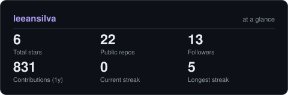



<picture>
  <source media="(prefers-color-scheme: dark)" srcset="assets/banner-dark.svg">
  <source media="(prefers-color-scheme: light)" srcset="assets/banner-light.svg">
  
</picture>

# Leandro Silva

  

---

## `whoami`

Soy **Lean**, Full Stack Software Engineer con más de **5 años de experiencia** creando aplicaciones web para empresas y organismos públicos. Me especializo en modernizar plataformas legacy y conectar interfaces modernas con los sistemas que ya están en producción.

- **En OCA**, trabajo en la evolución de **ePak**, una plataforma con más de **227.000 usuarios registrados**: migraciones de .NET MVC a React + TypeScript y liderazgo compartido del módulo Fulfillment.
- **Del frontend al backend:** interfaces con React y Next.js, APIs REST y arquitectura BFF con NestJS, integrando ASP.NET, SOAP y SQL Server.
- **Antes:** soluciones web y mobile como freelance, y desarrollo con React, FastAPI y CI/CD en el sector público.
- **También construyo por curiosidad:** desde una wiki de Mortal Kombat hasta un cursor controlado con gestos de la mano.
- **Abierto a oportunidades remotas** en LATAM, US y Europa.

### `cat stack.config`

| Área | Herramientas y experiencia |
| --- | --- |
| Frontend | React · Next.js · TypeScript · Chakra UI |
| Backend | NestJS · Node.js · FastAPI · REST · SOAP |
| Mobile | React Native |
| Datos | SQL Server · SQLite · consultas SQL · caché |
| Calidad y entrega | Cypress · Docker · Git · CI/CD |
| Arquitectura | BFF · integración con ASP.NET · modernización progresiva |

---

## `ls projects/`

| Proyecto | Qué construí |
| --- | --- |
| [Portfolio](https://leandro-silva.vercel.app/) | Mi presentación, experiencia y proyectos. Next.js, Chakra UI y GitHub API, con tema claro y oscuro. |
| [Herrería Silva](https://herreria-silva.vercel.app/) | Una web para la herrería de mi padre, con contacto y herramientas para crear presupuestos. |
| [Cursor Hand](https://github.com/leeansilva/cursor-hand) | Control del cursor con gestos frente a la cámara: Python, MediaPipe, OpenCV y PyAutoGUI. |
| [UMK3 Wiki](https://github.com/leeansilva/ultimate-mortal-kombat3-wiki) | Una wiki de mi juego favorito, con React y una interfaz inspirada en el juego. |

[Más proyectos →](https://github.com/leeansilva?tab=repositories)

---

## `git remote -v`

Mi código vive en dos cuentas:

| Personal | Trabajo · OCA |
| :---: | :---: |
| [**@leeansilva**](https://github.com/leeansilva) | [**@lsilva-oca**](https://github.com/lsilva-oca) |
| Proyectos propios y experimentos | Desarrollo profesional en OCA |

<picture>
  <source media="(prefers-color-scheme: dark)" srcset="assets/card-stats-dark.svg">
  <source media="(prefers-color-scheme: light)" srcset="assets/card-stats-light.svg">
  
</picture>

Estadísticas de la cuenta personal. El trabajo privado de OCA no está representado aquí.

  

Hecho con curiosidad, café y código · @leeansilva

